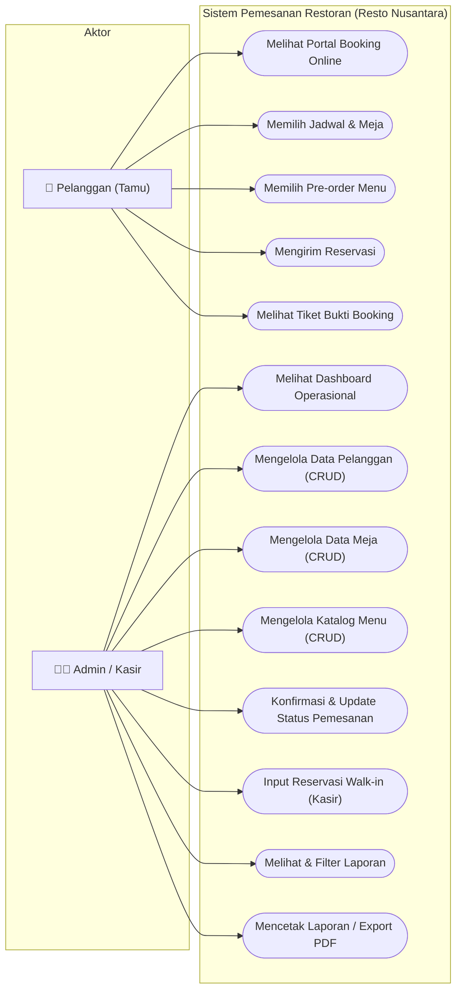
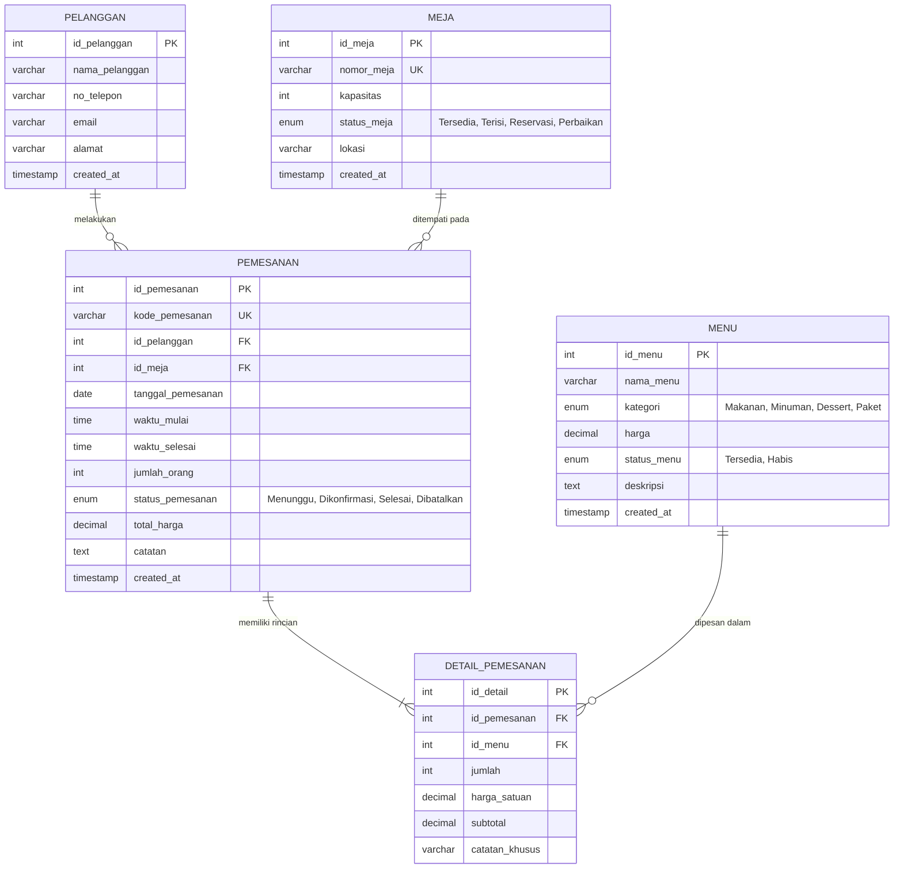

# DOKUMEN DIAGRAM PERANCANGAN SISTEM
## Resto Nusantara — Sistem Pemesanan Restoran
*Sesuai Instruksi Soal Bagian III No. 2: Use Case Diagram, Activity Diagram, dan Entity Relationship Diagram (ERD)*

---

## 1. USE CASE DIAGRAM

Diagram ini memetakan interaksi antara dua aktor utama: **Pelanggan (Tamu)** dan **Admin / Kasir Restoran**.



---

## 2. ACTIVITY DIAGRAM (ALUR PROSES RESERVASI & PENGELOLAAN)

Diagram ini menggambarkan alur kerja sejak pelanggan melakukan reservasi online hingga admin memproses dan mencatat laporan di kasir.

```mermaid
flowchart TD
    Start([Mulai: Pelanggan Buka Web]) --> BukaForm[Buka Halaman Booking Online]
    BukaForm --> IsiData[Isi Nama, No. WhatsApp, Email]
    IsiData --> PilihWaktu[Pilih Tanggal & Jam Kedatangan]
    PilihWaktu --> PilihMeja[Pilih Meja Sesuai Kapasitas]
    
    PilihMeja --> CekKapasitas{Jumlah Tamu <= Kapasitas Meja?}
    CekKapasitas -- Tidak --> PeringatanKapasitas[Tampilkan Peringatan Meja Penuh]
    PeringatanKapasitas --> PilihMeja

    CekKapasitas -- Ya --> PreOrder[Pilih Menu Pre-order (Opsional)]
    PreOrder --> KirimBooking[Klik 'Konfirmasi & Kirim Reservasi']

    KirimBooking --> CekJadwal{Cek Bentrok Jadwal Meja di Database?}
    CekJadwal -- Ada Bentrok --> ErrorJadwal[Munculkan Pesan: Meja Sudah Dipesan pada Jam Tersebut]
    ErrorJadwal --> PilihWaktu

    CekJadwal -- Tidak Bentrok --> SimpanDB[(Database Transaction: Simpan Pelanggan, Pemesanan, & Detail Menu)]
    SimpanDB --> Tiket[Tampilkan Tiket Bukti Booking (Status: Menunggu)]

    Tiket --> AdminNotif[Data Masuk ke Dashboard Admin]
    AdminNotif --> AdminReview[Admin Review Daftar Reservasi Masuk]
    
    AdminReview --> UpdateStatus{Tamu Tiba di Resto?}
    UpdateStatus -- Ya --> Konfirmasi[Admin Ubah Status: 'Dikonfirmasi']
    Konfirmasi --> SelesaiMakan[Tamu Selesai Makan & Bayar]
    SelesaiMakan --> SelesaiStatus[Admin Ubah Status: 'Selesai']
    
    UpdateStatus -- Batal --> Batalkan[Admin Ubah Status: 'Dibatalkan']

    SelesaiStatus --> RekapLaporan[Transaksi Masuk ke Laporan & Omset]
    Batalkan --> RekapLaporan
    RekapLaporan --> Cetak[Admin Cetak Rekap Laporan Resmi]
    Cetak --> End([Selesai])
```

---

## 3. ENTITY RELATIONSHIP DIAGRAM (ERD)

Diagram relasi basis data antar tabel dalam database `db_pemesanan_restoran`:



---

## 4. PENJELASAN KARDINALITAS RELASI (RELATIONSHIP CARDINALITY)

1. **`PELANGGAN` ke `PEMESANAN` (One-to-Many / $1:N$):**
   * Satu pelanggan dapat melakukan banyak kali reservasi pemesanan meja.
   * Satu transaksi pemesanan wajib terhubung ke tepat satu pelanggan (`id_pelanggan`).

2. **`MEJA` ke `PEMESANAN` (One-to-Many / $1:N$):**
   * Satu meja dapat dipesan berkali-kali pada tanggal dan jam yang berbeda.
   * Satu transaksi pemesanan hanya menempati satu meja tertentu (`id_meja`).

3. **`PEMESANAN` ke `DETAIL_PEMESANAN` (One-to-Many / $1:N$ - Cascade Delete):**
   * Satu reservasi pemesanan dapat memiliki banyak item pesanan menu makanan/minuman.
   * Jika data pemesanan dihapus, seluruh detail pesanan menu terkait otomatis terhapus (`ON DELETE CASCADE`).

4. **`MENU` ke `DETAIL_PEMESANAN` (One-to-Many / $1:N$):**
   * Satu menu dapat dipesan dalam banyak transaksi pemesanan yang berbeda.
   * Satu baris detail pesanan merujuk ke satu menu spesifik (`id_menu`).
